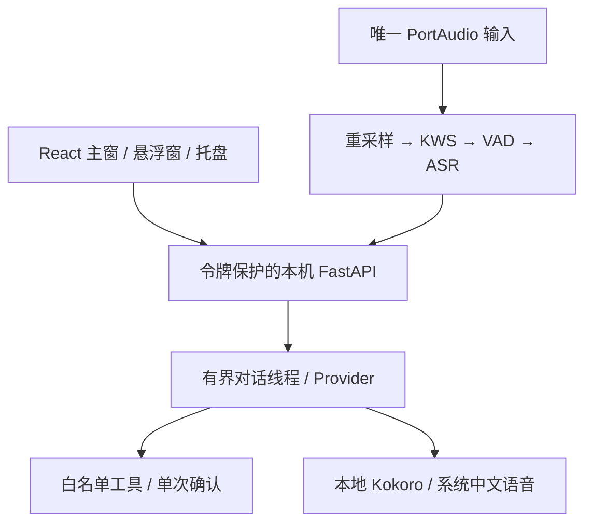

# 司聆 0.4.0 架构

Windows 11 x64 是目标；Windows Server 2022 CI 用于软件验证。Python 3.12 与 Tauri2 隔离运行，
模型使用 CPU。工程与司忆及其他项目无依赖。

## 状态与音频所有权

初始 MUTED；用户开始后 IDLE→WAKE_DETECTED→LISTENING→TRANSCRIBING，
仅转写时回 IDLE，启用对话则 THINKING→ACTING/SPEAKING→IDLE；无音频采集时回 MUTED。
录音线程单独持有麦克风；对话忙碌期间关闭输入，完成后重开，避免播放回声进入 KWS。
PTT/取消可中断 HTTP、生成回调和播放分块；同步 ASR 完成后抑制已取消结果。
半双工不支持播报时免按键语音打断；真实声卡/回声仍须硬件验收。

输入为 16 kHz/512 samples；原生采样率使用 soxr 连续转换。VAD 阈值 0.5，保留约 320 ms 前置缓冲。
默认等待开口 6 s、静音 700 ms、最长录音 15 s、冷却 900 ms；有界队列，设备至多恢复四次。
提示音期间清空积压；建议提示音后说命令，不承诺唤醒词与命令无停顿时首字无损。

## Provider 与工具

Provider 支持 disabled/mock/loopback Ollama/HTTPS OpenAI 兼容。云服务需明确同意，
仅发送文本与最长 12 轮上下文。HTTP 总时限 2–120 秒，响应最大 1 MiB，取消会关闭请求，
不使用环境代理或跟随重定向；没有真实 Key 的验证使用协议 mock，不能称为真实 AI。

工具仅 open_app/open_configured_folder/set_volume/get_system_info，参数严格 schema。
应用/目录从用户配置 ID 查找，禁止模型提供路径/脚本；执行前再次验证路径。
默认修改操作需要 60 秒有效、随机、单次确认票据；只读系统信息直接返回。
模型文本无法修改策略；用户主动选择 trusted 也只信任既定白名单，不开放 shell。

## 进程、密钥与数据

Tauri 使用固定 sibling SiLing-Voice.exe，随机 loopback 端口及每次启动随机令牌。
ready.json 置于私有临时目录，前端通过 Tauri command 获取连接；无 CDN、远程脚本或遥测。
Windows mutex 限制桌面单实例，语音服务另有系统文件锁。
Job Object 在正常/异常宿主退出时清理整个冻结程序树；sidecar 异常退出至多重启三次，
先关闭旧 Job 再重启，防止 PyInstaller 残留服务抢占锁；恢复保持静音。
关窗隐藏到托盘；退出终止服务。用户自启写 HKCU Run，卸载清理自启值，不默认启用。

Key 用当前用户 DPAPI 加密，设置/错误/状态不回显 Key。音频只在内存，事件最多 128，
界面最多 24 条；历史默认不落盘，可选保存与清空。工具审计仅类型/结果/耗时。
导出诊断严格构造字段白名单，错误码也用固定集合，不打包配置、原始日志、音频、正文或路径。
接口令牌保护、Host 白名单、受限 CORS；不抵御已取得用户权限的本机恶意程序。

## 主要 API（均 Bearer，/health 除外）

| 接口 | 功能 |
|---|---|
| GET /api/status、/api/devices | 状态、有限事件、输入设备 |
| POST /api/control | 开始/静音/唤醒/PTT/取消/清空/退出 |
| PUT /api/settings | 校验、停止监听、保存设置 |
| POST /api/chat、/api/credential、/api/credential/delete | 文字对话与安全 Key 管理 |
| PUT /api/tools/config、GET /api/tools/discover、POST /api/tools/confirm | 白名单与确认 |
| POST /api/desktop/autostart | 用户显式设置自启 |
| GET /api/diagnostics、/api/diagnostics/download | 脱敏 JSON/ZIP |

## 模型供应

官方 URL、大小与 SHA-256 固定；下载仅显式命令，归档检查拒绝链接和路径穿越。
逐文件 receipt 在启动时验证。KWS/VAD/ASR 与 Kokoro 分开安装，安装包不含权重。
权重许可与代码分别核验；KWS 独立权重许可未确认，见 THIRD_PARTY_NOTICES.md。
