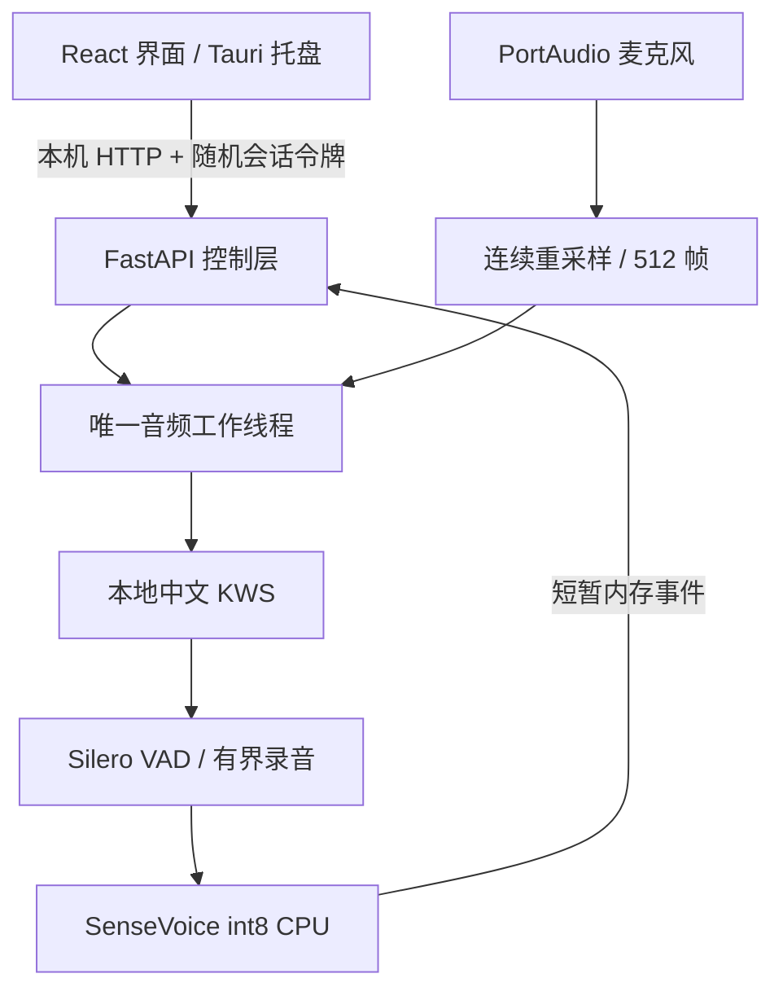
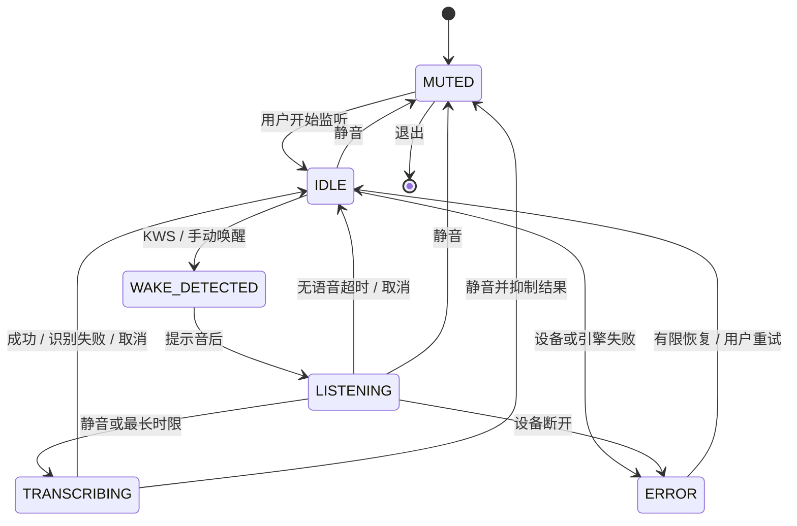

# 司聆 R0/R1 架构

## 运行边界

Windows 11 x64 / Python 3.12 是目标。构建 runner Windows Server 2022 只证明软件可构建和可启动，
不能证明 Windows 11 麦克风、蓝牙、声卡、睡眠恢复或音响回声表现。
项目独立于 SiYi/司忆及其他游戏仓库；本轮没有导入其他项目代码或配置。

KWS 在 IDLE 执行，不把待机音频写磁盘或交给 ASR。唤醒后停止 KWS，播放 90 ms 的本地提示音，
清空其积压输入，再进入 LISTENING。R1 建议按提示音后开始说话；唤醒词与命令无停顿连续说的
情况尚未优化，不承诺无损保留首字。模型检测延迟及排队缓冲属于后续实机测量范围。

## 状态和端点

- 固定输入：16 kHz、单声道 float32、512 samples（32 ms）。原生 44.1/48 kHz 使用 libsoxr
  有状态重采样，不在每个回调边界重置滤波器。
- Silero 窗口 512，threshold 0.5，最短活动 64 ms；录音器再要求至少 200 ms 语音。
  捕获开始后保留约 320 ms 的前置缓冲，避免 VAD 触发延迟截掉命令首字。
- 等待开口 6 s；连续静音 700 ms 结束；总录音最长 15 s；静音阈值可配置。
  所有时限按样本数量计时，WAV 加速回放与真实音频使用同一逻辑。
- 唤醒只在 IDLE 生效，完成后冷却 900 ms。ASR/提示音期间的输入积压会丢弃，避免回声、旧音频
  或计算耗时挤压下一轮。输入队列最多 64 块，溢出明确报错和重新打开设备。
- 取消清空当前录音；同步原生 ASR 正在运行时不能强制中断 C++ 运算，立即抑制转写结果，等调用
  返回后处理取消。静音即时请求释放设备；完全退出时宿主终止 sidecar，操作系统回收句柄。
- 设备失败至多尝试 4 次；用户静音期间停止恢复。引擎加载期间静音会阻止随后打开麦克风。

## 进程与单实例

Tauri 嵌入前端，启动同目录 `SiLing-Voice.exe`，让服务绑定 loopback 随机端口。父进程通过私有
临时目录里的 ready.json 接收 URL 和每次启动随机生成的令牌，并只通过受限的 Tauri command
传给窗口。启动超时或子进程提前退出时明确失败。退出宿主会终止并回收子进程。
桌面关窗隐藏到托盘；R3 再补托盘录音状态、托盘静音及自启动开关。

语音服务用进程文件锁防止两个实例争抢麦克风；Windows 使用 msvcrt，Linux 使用 flock。
第二个进程报错退出，不删除锁文件，不通过“检测 PID 后删除锁”引入竞争。
R1 第二实例尚不负责聚焦已有窗口。

开发或便携浏览器模式可独立运行同一服务。启动器把令牌放在 URL fragment，前端立即移出地址栏，
保存在当前标签会话内存/会话存储中；API 日志默认关闭，不把令牌或识别正文写入日志。
页面和包内资源本地提供，不加载 CDN、追踪器或云服务。

## 权限和数据契约

| 端点 | 权限 | 内容 |
|---|---|---|
| GET /health | 无 | 固定软件名和版本，不含状态、设备、正文 |
| GET /api/status?after=N | Bearer | 状态、音量、当前配置和新事件 |
| GET /api/devices | Bearer | 输入设备枚举 |
| POST /api/control | Bearer | start / mute / wake / cancel / clear / exit |
| PUT /api/settings | Bearer | Pydantic 严格校验配置；停止监听后保存 |

接口仅绑定 127.0.0.1，Host 白名单、受限 CORS、不缓存响应；不允许任意文件路径上传或 shell。
此设计防止普通外部网页直接控制录音，不抵御已获得用户权限的本机恶意程序。
契约在 packages/contracts/index.ts，后端同名字段与测试检查相同状态。
当前不含云 Key、LLM、系统工具、对话历史数据库或权限升级路径。

音频片段只在内存，转写事件有界为 128 条；界面最多展示 12 条。静音/清空/退出会清理正文。
保留的 settings.json 只含输入设备、唤醒词、时限和阈值。原始录音无默认保存路径。
显式 CLI WAV 测试会输出正文；`--output` 由执行者主动要求保存，不纳入默认诊断日志。

## 模型和离线部署

`models.lock.json` 固定官方 URL、大小、上游 SHA-256。显式安装先验证整个归档，再检查 tar
条目，拒绝路径穿越、链接和异常体积；完成后记录必需模型文件的逐文件哈希。
每次真实引擎启动验证这些文件，不在运行时静默下载模型或回退到云端。
权重和代码许可分别核验，未确认项保留在 THIRD_PARTY_NOTICES.md，不写成已解决。
